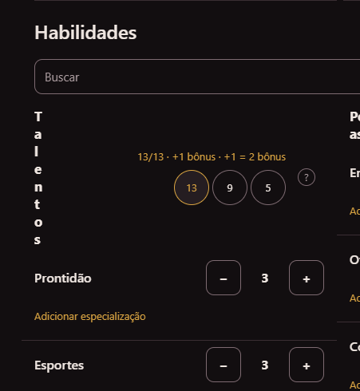

# Notas do teste: criação de ficha

O que não ficou bom no teste manual da criação de ficha.

## Lobisomem: identidade

- O campo aparece como **"feito"** em vez de **"efeito"**.
- **Seita** e **Campo** precisam de um ponto de interrogação (?) que explique o que são:
  - **Seitas (Septs):** a dinâmica sagrada das comunidades Garou, a hierarquia delas (do Guardião ao Mestre do Rito) e os Caerns espirituais que protegem.
  - **Campos (Camps):** as facções políticas, ideológicas ou táticas que existem dentro de cada uma das grandes Tribos Garou, e como elas influenciam a visão de mundo e os deveres do personagem.

## Navegação entre abas

- Quando uma aba termina de ser preenchida (por exemplo, a Ficha), a próxima aba (Vantagens) deveria ganhar destaque, para o jogador saber que precisa ir para lá.

## Pontos de bônus

- No aviso *"Conhecimentos: os 5 pontos básicos já foram usados. Para passar disso, use os pontos de bônus (2 por ponto)."*, o texto também deveria dizer que a etapa dos pontos de bônus vem depois que a ficha inteira estiver preenchida.
- O modal que avisa o início dos pontos de bônus deveria fechar só pelo botão. Cliquei sem querer fora dele, o modal fechou e perdi o aviso.

## Habilidades: título de Talentos quebrado

- O título **"Talentos"** aparece letra por letra, na vertical, e a coluna da direita fica cortada.

## Qualidades e Defeitos

- Ao adicionar uma qualidade ou um defeito, já deveria aparecer uma lista com os de custo fixo.
- Para uma qualidade ou um defeito livre, deveria dar para informar quantos pontos ele vale no momento de adicionar.
